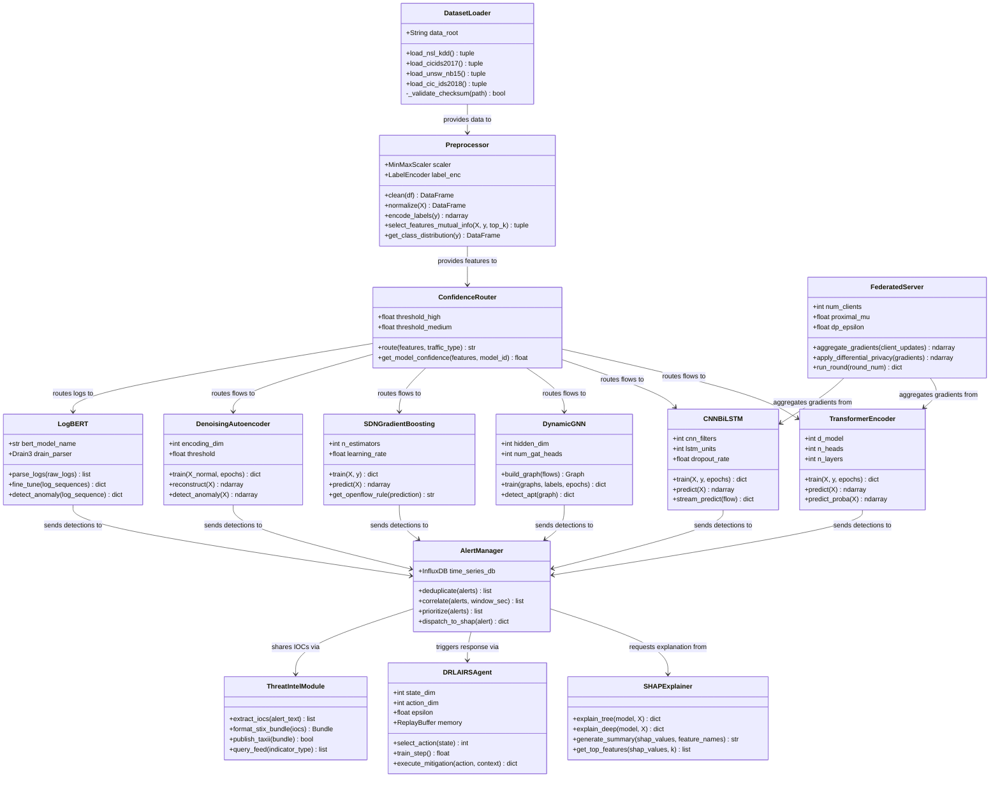

# UML Class Diagram
## AI-Powered Cloud Intrusion Detection Platform

---

## Class Responsibilities Summary

| Class | Responsibility | Pattern |
|---|---|---|
| `DatasetLoader` | Unified interface for all 4 benchmark datasets | Facade |
| `Preprocessor` | Cleaning, normalization, feature selection | Strategy |
| `ConfidenceRouter` | Traffic-to-model dispatch decisions | Chain of Responsibility |
| `TransformerEncoder` | High-dimensional feature dependency classification | ML Model |
| `CNNBiLSTM` | Spatial-temporal streaming traffic detection | ML Model |
| `DynamicGNN` | Topology-aware APT/lateral movement detection | ML Model |
| `SDNGradientBoosting` | Line-rate volumetric DDoS detection | ML Model |
| `DenoisingAutoencoder` | Unsupervised zero-day anomaly detection | ML Model |
| `LogBERT` | Cloud audit log sequence anomaly detection | ML Model |
| `SHAPExplainer` | Feature attribution for all high-severity alerts | Decorator |
| `FederatedServer` | Gradient aggregation with FedProx + DP | Aggregator |
| `DRLAIRSAgent` | Adaptive automated threat mitigation policy | Agent |
| `ThreatIntelModule` | STIX/TAXII IOC extraction and sharing | Publisher |
| `AlertManager` | Alert deduplication, correlation, and dispatch | Mediator |
