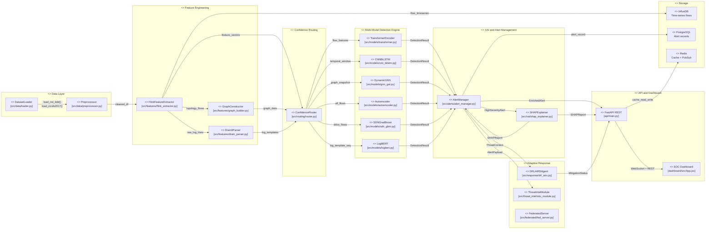

# UML Component Diagram
## AI-Powered Cloud Intrusion Detection Platform
### Platform Component and Interface Specification

---

### Interface Specifications

| Interface | Provider | Consumer | Data Format |
|---|---|---|---|
| `load_nsl_kdd()` | DatasetLoader | Preprocessor | `(DataFrame, DataFrame)` |
| `clean(df)` | Preprocessor | FeatureExtractor | `DataFrame` (no inf/NaN) |
| `feature_vectors` | FlinkExtractor | ConfidenceRouter | `ndarray [n_flows, 80]` |
| `DetectionResult` | All model components | AlertManager | `{label, confidence, features, timestamp}` |
| `HighSeverityAlert` | AlertManager | SHAPExplainer | `{alert_id, features, model_type}` |
| `SHAPReport` | SHAPExplainer | AlertManager | `{top_features, shap_values, summary_text}` |
| `ThreatContext` | AlertManager | DRLAIRSAgent | `{attack_type, severity, source, service}` |
| `AlertPayload` | AlertManager | ThreatIntelModule | `{ioc_candidates, alert_text, timestamp}` |
| `POST /api/v1/detect` | FastAPI | External | JSON: `{features: [...]}` |
| `GET /api/v1/alerts` | FastAPI | SOC Dashboard | JSON: `[{alert_id, severity, shap_url}]` |
