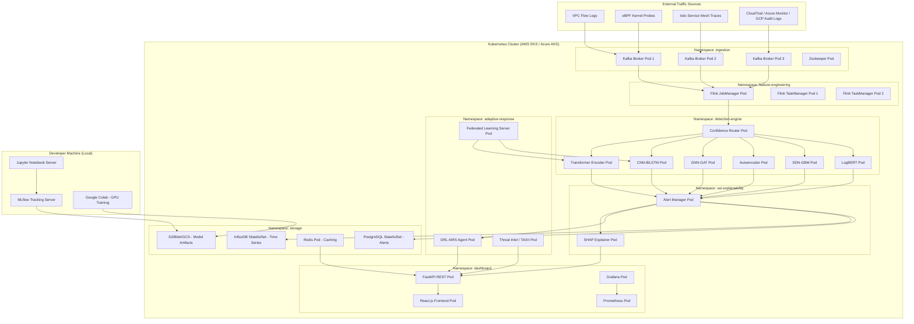

# UML Deployment Diagram
## AI-Powered Cloud Intrusion Detection Platform
### Kubernetes Cloud-Native Deployment Architecture

---

### Node Specifications (Zero-Cost Strategy)

| Node / Service | Development Phase | Production Phase (Student Cloud) |
|---|---|---|
| **Kafka Cluster** | Local Docker Compose | AWS MSK (free tier) / Azure Event Hubs |
| **Flink** | Local single-node | AWS Kinesis / Azure Stream Analytics |
| **Detection Models** | Google Colab T4 GPU | AWS EKS (Educate credits) |
| **InfluxDB** | Local Docker | InfluxDB Cloud Free Tier |
| **PostgreSQL** | Local Docker | AWS RDS Free Tier |
| **MLflow** | Local (port 5000) | Self-hosted on EC2 t2.micro (free tier) |
| **Grafana** | Local Docker | Grafana Cloud Free Tier |
| **Total Cost** | **Rs 0** | **Rs 0 (student credits)** |
