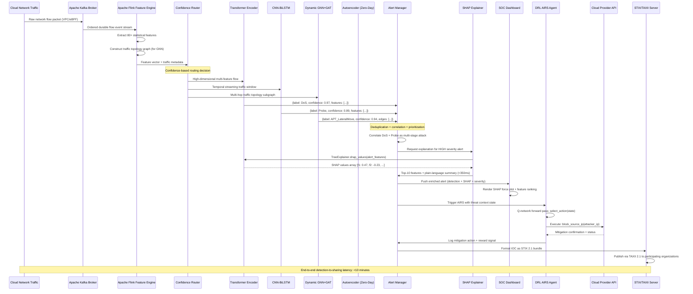
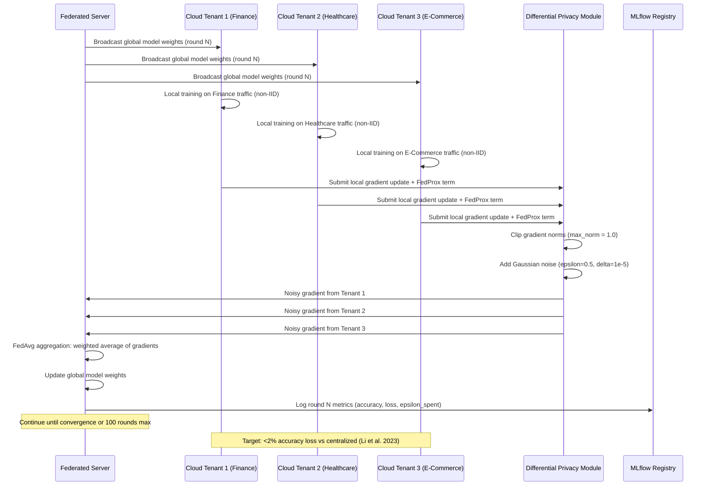

# UML Sequence Diagram
## AI-Powered Cloud Intrusion Detection Platform
### Primary Sequence: End-to-End Intrusion Detection with Explanation and Automated Response

---

### Secondary Sequence: Federated Learning Round

